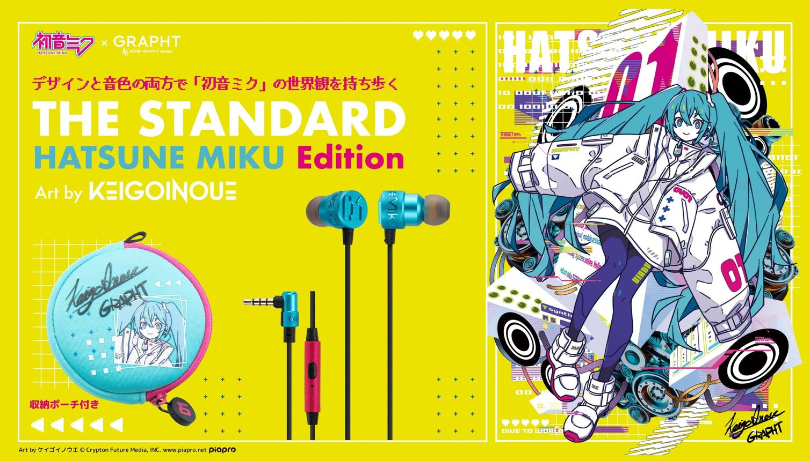

## Hi there 👋

<div align="center">



<br>

**「好きなことで、進んでいく。」**

*Keep learning. Keep creating.*


</div>

---

### 01. ABOUT ME // 自己紹介

```yaml
NAME: Sans（Anran)
ROLE: Computer Science Student
STATUS: Learning & Exploring

INTERESTS:
  - Artificial Intelligence
  - Frontend Development
  - Creative Coding
  - Anime & Music

CURRENT_MISSION: Turn ideas into reality
```

> 🌐 欢迎来到我的小小世界。
>
> 喜欢编程、AI，也喜欢有设计感的作品。
>
> 正在学习如何用代码实现自己的想法。
>
> ✦ まだ、はじまったばかり。

---

### 02. SKILL SET // スキル

<div align="center">

**PROGRAMMING & TOOLS**


<br><br>

**EXPLORING NEXT**


<br>

<sub>✦ New skills are being unlocked... ✦</sub>

</div>

---

### 03. CURRENT QUEST // 進行中

- [x] 01 / Start my coding journey
- [x] 02 / Create a GitHub profile
- [ ] 03 / Build a personal website
- [ ] 04 / Explore AI applications
- [ ] 05 / Create something wonderful

---

### 04. PROJECT ARCHIVE // 制作記録

| NO. | PROJECT | STATUS |
|:---:|:---|:---:|
| 01 | [anran](https://github.com/sansv272-code/anran) | Exploring |
| 02 | Personal Website | Planned |
| 03 | Creative AI Project | Coming Soon |

---

### 05. GITHUB RECORDS // 活動記録

<div align="center">


<br>


</div>

---

<div align="center">

### ✦ 少しずつ、前へ。✦

**MUSIC × CODE × FUTURE**

`01 / SANS` · `CREATIVE LOG` · `TO BE CONTINUED...`

*Thank you for visiting my little world.*

</div>
